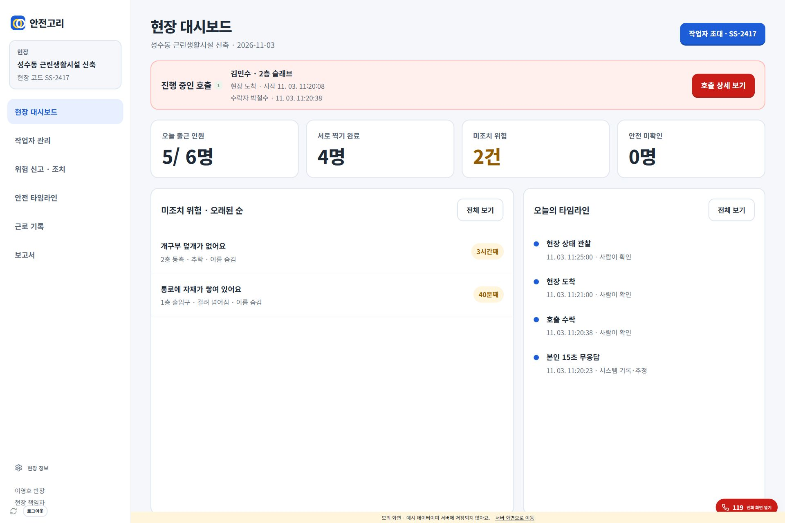

# 관리자 웹 와이어프레임 검증

기준: 사용자 첨부 W-1~W-7 및 공용 관리자 메뉴. PR1 `ba534e1`의 NestJS 연결 위에 구현.

## 구현

- W-1: 진행 호출, 출근·사진 확인·위험·미확인 지표, 오래된 위험과 최신 타임라인
- W-2: 작업자 5열 표, 동료 배정과 반장 보호구 확인 창, 이름·구역·직종 검색
- W-3: 상태 필터, 오래된 미조치 우선 표와 선택 상세, 조치 요청·증빙 저장·독립 재확인
- W-4: 사람 확인과 시스템 추정 구분, 날짜 조회, 서버 원본 검사, 정정 요청·검토
- W-5: 4개 월간 지표, 작업자별 표, 월 변경·PDF·CSV, 일별 출퇴근
- W-6: 월간 집계·사고 경위·개별 근로 기록 카드, 월·작업자·기간 선택과 미리 보기
- W-7: 독립 호출 상세, 전달 단계별 시각, 현장 확인·대응, 119 기록과 보고서
- 작업자 앱의 하단 탭·출퇴근·센서 흐름은 이번 관리자 웹 범위에 추가하지 않음

## 확인 결과

- `npm run build`: 통과
- `npm test`: 32개 통과 (API 인증·취소·사진 재시도·보고서 범위·기록 규칙·Windows 실행 포함)
- IAB 브라우저에서 동일 화면 컴포넌트를 쓰는 `?demo=1`로 7개 화면 확인
- 1920px 데스크톱과 390px 모바일 폭 확인. 좁은 표는 표 안에서 가로 스크롤
- 위험 상태 필터와 상세 전환, 동료 배정 창, 담당자 선택 후 요청 버튼 활성화 확인
- 조치 사진 미첨부 시 완료 저장 비활성화 확인
- 보고서에서 작업자 선택 시 해당 작업자만 미리 보기, 월 변경 시 이전 미리 보기 제거 확인
- 호출 상세 진입·대시보드 복귀, 브라우저 오류 로그 없음 확인
- 타임라인은 검사 전 미검사이며, 검사 결과가 있을 때만 연결 일치 여부 표시

실제 NestJS·PostgreSQL에 쓰는 종단 검증, 실기기 푸시·카메라·전화 앱 실행은 이번 변경에서 재실행하지 않음. 예시 화면은 실제 서버에 요청하거나 데이터를 저장하지 않으며, 다운로드를 실제 보고서로 가장하지 않음.

`scripts/qa-admin.mjs`, `scripts/qa-live-admin.mjs`의 선택자는 새 UI에 맞게 갱신했으나 이번 검증에서는 해당 Playwright 스크립트를 실행하지 않고 IAB로 확인함.

